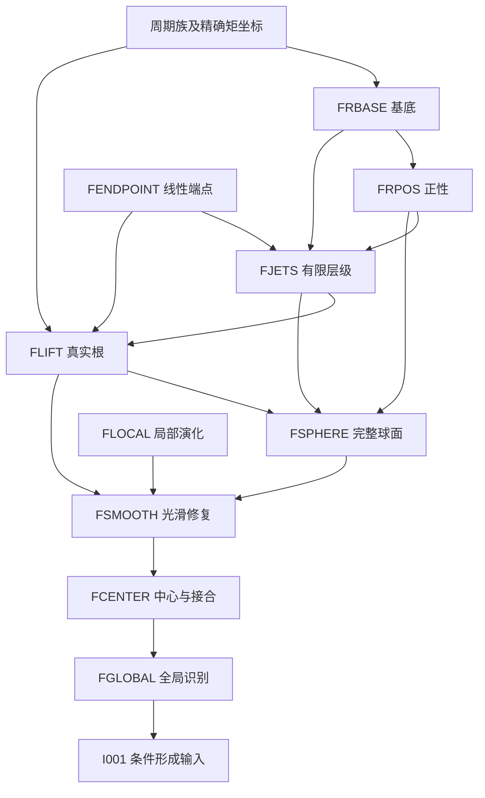

# RECCVS 阶段0第一轮自我审查（修订版 v2）

日期：2026-10-11。审查对象是本轮阶段0的L001–L023登记表与依赖图；本报告替代其有修改的登记条目，原证明稿与v1交付件保持不变。

## 结论与验收范围

逐稿对照后，发现11项登记问题：2项严重、7项中等、2项轻微。严重等级表示足以误导前置可用性或无循环判定，不表示已经证明原数学定理错误。全部登记修正已写入v2；未取得的实际输入与独立数学审查仍保持开放。A–D状态没有变化。

最关键的修正是：补足提升的精确矩坐标假设；将线性端点可逆性与非线性完整球面实现拆开；把L015分情况证明显式分支化。旧“图可拓扑排序”的检查只能说明登记数组无环，不能覆盖复合节点内部的顺序，这一限制必须实际体现在数据结构中。

本轮读取23份原稿全部正文，以及形成输入相关小节、旧78项结论与36项输入记录；按陈述、实际证明调用位置、假设与域做对照。没有运行端点求根、PDE发展或历史数学认证脚本，没有把外部论文的全文适用性独立审查标为完成。核对原稿论证中的分支/接口用于修正登记，未启动新的构造或实质性证明。

## 问题清单与修正建议

| 编号/严重度 | 问题与影响位置 | 发现 | 修正 | 原稿依据 |
| --- | --- | --- | --- | --- |
| SR01 / 严重 | 有限阶提升漏登精确矩坐标条件；PERIODIC_PROFILE / FLIFT | 旧输入只列周期性、电流/核正性及λ<μ，未列M_s(z_c)=c_s；这些条件本身不保证参数的端点Jacobian可逆。 | 补登记矩坐标、所需参数导数一致界、均值统一正下界、τ0位于参数区间内；L021.FAMILY供应矩坐标，L021.KERNEL供应核/耦合余量。 | `RECCVS/inputs/formation/RN-Black-Hole-Lab/proof/finite_order/03_nonlinear_lifting.md` L141–149；`RECCVS/proofs/RECCVS_L021.md` L95–102 |
| SR02 / 严重 | 端点输入把前提与后续球面实现合并；FENDPOINT / FLIFT | 旧FENDPOINT覆盖端点匹配§1–5并同时称为完整球面数据；§5使用非线性提升的jets及端点匹配，不能整体置于FLIFT之前。旧机器DAG无环不能证明此复合节点语义无环。 | 把FENDPOINT限为线性§1–4；新增FJETS、FSPHERE、SPHERE_KU。线性端点→有限jets/根→完整球面。形成稿有此拆分依据，未据此认定原数学证明存在不可消解循环。 | `RECCVS/inputs/formation/RN-Black-Hole-Lab/proof/finite_order/02_endpoint_matching.md` L49–61；`RECCVS/inputs/formation/RN-Black-Hole-Lab/proof/finite_order/03_nonlinear_lifting.md` L141–149 |
| SR03 / 中等 | 分情况证明被平铺为统一前置；L015.OUTER / L015.LIFETIME | 旧依赖数组不标分支，可能将c=0与c>0、t_end有限与无限的额外假设同时施加；尤其有限t_end情形可在t=1前终止，根本不需要OUTER。旧文字说明正确，机器表达未兑现。 | 新增NEAREDGE、FINITETIME、INFINITETIME；用带condition的case_rules与覆盖理由记录互斥穷尽分支。 | `RECCVS/proofs/RECCVS_L015.md` L23–28；`RECCVS/proofs/RECCVS_L015.md` L104–121 |
| SR04 / 中等 | 局部域、膨胀号及全局可见性被捆绑；L003 / L004 / L005 / L010 / L012 | POS_DOMAIN同时要求ν<0，VIS兼有物理归一化与I+可见性；局部潮汐/输运无需这些全部条件。L004.IDENTITY仅覆盖正膨胀面积式，L005仿射电荷式却允许r_s非正，旧依赖未区分。 | 拆SMOOTH_DOMAIN、NU_NEG、AFFINE_NORM；新增L004.AFFINE和L005.AREA。只在陷俘号数或除ν时引入负号，只在全局逃逸结论引入VIS。 | `RECCVS/proofs/RECCVS_L003.md` L3–12；`RECCVS/proofs/RECCVS_L004.md` L7–18；`RECCVS/proofs/RECCVS_L005.md` L11–25；`RECCVS/proofs/RECCVS_L010.md` L7–26 |
| SR05 / 中等 | Robin版本继承了不适用的中心DN前提；L018.ROBIN | 旧ROBIN直接依赖SIGN；SIGN明确从r(0)=0、r_s(0)=1及f(0)=0出发，不能无说明用作r(0)>0的前提。 | 提取共有ground-state恒等式；DN与Robin分别使用CENTER_INTERVAL/POS_INTERVAL和各自二次型，Robin记录w0边项。 | `RECCVS/proofs/RECCVS_L018.md` L7–28；`RECCVS/proofs/RECCVS_L018.md` L40–46；`RECCVS/proofs/RECCVS_L018.md` L95–101 |
| SR06 / 中等 | 尾部求和被过度绑定于完整形成链；L022.TAIL | 从逐步预算推出Ck尾界只需该预算已兑现，不需先证明FLIFT、完整FSMOOTH；旧表让独立求和接口继承了端点根和中心实现。起算阶N0也未显式登记。 | 直接依赖REPAIR_BUDGET，要求N≥max(N0,k+1)；FSMOOTH仅作为预算供应实例。锥C1预算到真实强拓扑仍保留独立未验证门REPAIR_TO_STRONG。 | `RECCVS/proofs/RECCVS_L022.md` L7–21；`RECCVS/proofs/RECCVS_L023.md` L165–173 |
| SR07 / 中等 | 几何门槛误继承端点根存在前置；L023.MGEOM | 旧MGEOM经FIRST间接依赖FLIFT，与正文“几何门槛未认证此m的根”不一致；这是机器图过强依赖，旧人类可读限制本来正确。 | MGEOM改依赖有限锥约束、L021族与历史代数证书；BRANCH另合并真实根、整锥填充、电荷/物理宽度及An–Lim接口。 | `RECCVS/proofs/RECCVS_L023.md` L140–159 |
| SR08 / 中等 | 假设摘要遗漏特化与估计区间；L002.DATA / L007.STRIP / L017.SHARP / FRBASE / FRPOS | L002旧摘要未列实f,g及K=0/Π纯虚的动量约束配置；L017逐命题项未列ν<0（整稿表已列）。FRPOS的q≥aδ漏写x≥T，x=0处其实q=0；FRBASE的R与1/R统一界只限x≤L。有限T的jets阶数/常数范围也需明确。 | 补全特化条件、q下界的周期后范围及R控制的有限脉冲范围；逐结论关联原输入陈述区间，保留旧记录供比较。短摘要不能代替原定理。 | `RECCVS/proofs/RECCVS_L002.md` L5–19；`RECCVS/proofs/RECCVS_L002.md` L38–40；`RECCVS/proofs/RECCVS_L007.md` L7–24；`RECCVS/proofs/RECCVS_L017.md` L7–7；`RECCVS/inputs/formation/RN-Black-Hole-Lab/proof/finite_order/04_radius_positivity.md` L7–13；`RECCVS/inputs/formation/RN-Black-Hole-Lab/proof/finite_order/03_nonlinear_lifting.md` L21–25 |
| SR09 / 中等 | 矩修复的系数包络证书依赖未登记；L021.FIX / E021 | L021§2用于尾界/矩残差的归一化系数上界由certify_admissible_profile.py核查；旧FIX只指L020而没有登记E021这项证据。存在数据文件不等于已复跑。 | FIX新增E021，关联§1–2；明确有理系数包络与正文解析cutoff/bump积分修复承担不同证明部分，历史脚本仍标未重跑。 | `RECCVS/proofs/RECCVS_L021.md` L35–49 |
| SR10 / 轻微 | 延续机制只在文字中登记；L012.EXIST | 原稿明确使用L009§4同一延续机制；旧JSON仅将其写入assumptions，未在边中体现。不能改为直接引入L009楔域结论，否则会多带Ut≤c。 | 新增独立的条件性L009.CONTINUE机制节点；L009.EXIST与L012.EXIST各用自身低阶界来兑现。 | `RECCVS/proofs/RECCVS_L009.md` L126–140；`RECCVS/proofs/RECCVS_L012.md` L180–186 |
| SR11 / 轻微 | 后续筛选示意边方向不一致；dependency_graph.application_or_explanatory_edges | 旧L001.EXCLUDE→L018.CERT标为downstream_screening，备注虽说不是谱证书前提，箭头仍可能被工具按前置方向解释。 | 新增应用节点L018.SCREEN，明确只在负谱/积分证书、固定Cauchy种子和强拓扑共同满足时同时消费L018.CERT与L001.EXCLUDE。解释边与证明/条件边分开。 | `RECCVS/proofs/RECCVS_L018.md` L89–91；`RECCVS/proofs/RECCVS_L001.md` L7–13 |

以上问题的“已修正”仅针对登记。SR01不能替代具体Jacobian/根认证；SR02不证明有限jets余项成立；SR03不证明外边延续/反向唯一性成立。

## 修正后的形成链与循环判定

FENDPOINT只保留线性背景§1–4。FJETS登记有限非线性jets；FLIFT登记真实根和局部非退化；FSPHERE登记根之后的完整球面数据。FSPHERE不再反向供给FLIFT的线性可逆性。

图为主要内部顺序；外部适定性与SPHERE_KU等仍按INPUTS_v2登记，图不表示这些输入已通过独立认证。

| 关系 | 修订判定 | 尚未关闭的责任 |
| --- | --- | --- |
| 旧FENDPOINT↔FLIFT | 旧复合节点有隐藏的反向语义引用；拆线性端点/FJETS/根/球面后消除登记层循环 | 逐式核对finite_order/03的层级误差与完整球面字段 |
| FRBASE→FRPOS→FJETS | 半径稿使用提升§2–3基底；提升§5再使用q≥aδ；可以按小节排序 | 核紧区间/尾区选参与C1常数待独立审查 |
| L014↔L015 | L014条件定理不使用L015构造的外边作为证明前提；L015提供实例后才应用 | 实际外边与MGHD识别仍是R06责任 |
| L015的c=0/c>0 | case_rules明确分开；无假设合并 | 需在同一t=1正则截面定义c |
| L015的有限/无限t_end | 有限分支直接用α_H正下界与轴式；无限分支才构造外边 | 实际轴线最大性/中心适定性接口待验收 |
| L022↔L023 | 先获得实际有限陷俘与共同稳定门，再用预算选择修复 | COMMON_FLOW/REPAIR_TO_STRONG不能由尾部求和反向取得 |

修订核心图可拓扑排序，未发现剩余的显式有向环或未定义节点。此判定仍限于已登记的结果/条件；未独立验收的解析证明可能有尚未识别的先验或遗漏，不能以图检验排除。

## 修正后的L001–L023整稿表

| 稿件 | 修正后核心/分支前置 | 输入假设 | 适用域 | 应用与限制 | 审查问题 |
| --- | --- | --- | --- | --- | --- |
| L001 有限时间严格陷俘的阈值排除 | SYS、TOPO、CAUCHY、PENROSE | 光滑约束数据、Σ≅R³空间完备；有限紧光滑区中有正半径严格陷俘球 | 固定参考片及其 X^s 相对邻域 | 黑洞集合应用另需完整 I+ 与可预测性接口；给不完备与不在闭包D/N；U⊂B 另有条件。 | SR11 |
| L002 受控正则约束初值曲线 | SYS、TOPO；约束 ODE | 固定0<r0<R0、实f,g∈Cc∞((r0,R0))及固定e；K=0、AΣ=0、φ0=pf、Π=-ipg；m(r0)=Q(r0)=0；小p使Δ≥1/2的bootstrap闭合；全部约束含动量/Gauss | 中心至唯一 AF 端的初始数据，全族固定支持/尺度 | L006 是后续应用；初始未陷俘、满足约束与光滑参数依赖；非零 p 的完整色散不由本稿给出。 | SR08 |
| L003 径向平行传播潮汐分量 | SYS、SMOOTH_DOMAIN、AFFINE_NORM；局部warped-product/Raychaudhuri | 实际仿射径向零线、固定初点物理归一化、平行角框架；不需ν<0或可见性 | 实际光滑正半径线段 | B/C 应用需真实增长、有限仿射与可见性；只将物理一阶导数变成潮汐分量；不推出K、有限参数或可见性。 | SR04 |
| L004 中心出射线对数聚焦 | SYS、REG_CENTER、AFFINE_NORM；仿射式与面积式分开 | 实际中心发出线，r_s(0)=b>0；面积坐标公式仅在r_s>0 | 仿射式覆盖全部实际光滑正半径段；面积指数式限r_s>0最大初始段；全局推论另加完整性/覆盖/I+ | 限定无黑洞推论另需全部中心线覆盖/完整性/同一I+；能量发散可来自r_s→0；不自动是曲率发散。 | SR04 |
| L005 电荷—聚焦与光滑反误判例 | L004.AFFINE用于仿射式；L004.IDENTITY用于面积式；SYS；CHAR用于局部反例 | Q(0)=0；正膨胀仅为面积坐标版条件；反例是独立正半径片 | 实际有限零线；另有光滑局部特征反例 | 陷俘排除应用另需振幅积分上界与反向膨胀；总电荷下界不给实际出射通量下界；局部反例不是全局形成解。 | SR04 |
| L006 小数据全局接口与部分完备性 | L002、SYS、KL | 固定e、N≥14、γ∈(1/2,1)，归一化与ADM/Coulomb主项扣除后小数据 | L002 的充分小振幅族；最终内锥线另限ρ≤(1-η)t | TOPO、VIS 的完整色散验收尚缺最后接口；径向零与最终内锥因果完备；一般非径向外锥线及完整I+未验收。 | 未发现新的登记错误 |
| L007 有限时间实际内侧未陷俘薄带 | I001 的实际内侧与 RN jets、SYS | 每个固定有限T已有实际矩形0≤U≤aT、1≤t≤T；RN的λ、λ_U、λ_UU匹配，ν_H<0；该紧矩形C4界有限；bT可随T退化 | 0<U≤bT，1≤t≤T | L001 是后续筛选；bT依赖T；形成期和深中心不覆盖；零jets不给非零尾系数。 | SR08 |
| L008 全入射截面聚焦与三次跨越 | SYS、POS_DOMAIN；MGHD用于ν传播 | 每个积分前缀实际存在；中心端项仅在完整正则中心截面置零 | 单个实际入射截面；形成期保留rHλH边项 | 中心公式需REG_CENTER；极端三跨越需外端jets；一次跨越保持是额外动力学条件；没有全未来无陷俘证明。 | 未发现新的登记错误 |
| L009 全时间未陷俘楔域 | L008.PREFIX、L010.TRANSPORT、HORIZON；L009.CONTINUE+CHAR延续 | 固定种子、e,a0,N,A；先定常数后定c,η | 0≤U≤η，t≥1，Ut≤c，r≥1/2 | I001、INSEG 用于同一MGHD识别；不覆盖Ut>c、形成期、深中心；引用后编号L010不构成循环。 | SR10 |
| L010 中心相容与电流号障碍 | SYS、SMOOTH_DOMAIN；不需ν符号；CHAR用于局部相位反例 | P=D_Uφ、T=D_tφ、A_t=0；保留Wilson相位 | 实际正半径特征片；到中心的复积分等式另有中心条件 | 中心复积分另需REG_CENTER、INSEG、HORIZON；I001用于原种子识别；复积分是中心必要条件；电荷比值无由正能量给出的最大值原理。 | SR04 |
| L011 全剩余域正通量预算 | SYS；L010用于Wilson式；L009用于楔域闭合 | 真实初始点/中心、真实存在段；晚时Wilson式需要视界零值 | 每条实际出射线；楔域或额外尾下界的条件性子域 | L001用于真实超支后的筛选；I001/INSEG用于视界积分；全深部预算尚未验证；尾下界及后续存在性没有取得。 | 未发现新的登记错误 |
| L012 固定宽度全时间实际内侧控制 | L008.PREFIX、L010.TRANSPORT、L012.KERNEL、HORIZON、L009.CONTINUE；CHAR | 同一C∞种子、全零视界jets；N先取足够大、A固定后缩η | 固定0≤U≤η、全部t≥1，r≥3/4 | I001/INSEG用于实际MGHD识别；全局边界解释另需完整视界；PP只需AFFINE_NORM；不覆盖深中心；曲率有界与连续度量延拓不给方程解/C²/C∞延拓。 | SR04、SR10 |
| L013 实际散射迹刚性与增长 | L012；SYS、HORIZON | 同一固定种子；反向吸收需N再增大、η再缩小 | 固定近视界条带，极限在闭U区间[a,η]；h积分到0需支配界 | 其外边供L014、L015应用；h>0依赖实际初始场非零；无初值族统一h/T下界。 | 未发现新的登记错误 |
| L014 抽象外边下的全余域体积与寿命 | SYS、OUTER_INPUT、实际连通前缀；L014.PREFIX→体积/中心截面/寿命分开 | 外边全部t≥1存在且α_b/t²→h_b>0；固定外边 | 更深实际连通余域；电磁/半径与轴式只在仍有正则中心时 | L013或L015按分支供应外边；REG_CENTER仅用于实际中心截面与轴线；外边输入为显式条件；不决定λ号、曲率或r=0延拓。 | 未发现新的登记错误 |
| L015 首个非零点与轴线有限固有寿命 | I001；外边分c=0用L013与c>0用本稿CHAR/反向唯一性；有限t_end直接用L014.AXIS；无限t_end再用OUTER+L014.LIFETIME | 同一MGHD全局标签、唯一最大正则轴线、入射连通/ν<0、完整视界；仅外边构造需要中心活到t=1 | 全部实际轴线寿命分支；c的两分支仅在t=1正则截面定义 | OUTER实例供L014；轴线结论供L016条件推论；有限类时固有长度；不等于零仿射奇点，轴线在黑洞内。 | SR03 |
| L016 正则中心曲率与物理导数 | SYS、REG_CENTER；L014.AXIS用于坐标表达 | 实际四维光滑正则中心；无磁荷；规范不变物理导数 | 中心事件及其逐事件趋轴极限 | L015+实际增长假设用于有限固有时曲率推论；K=(20/3)\|Dτφ\|⁴是局部恒等式；动态增长和趋轴统一界未取得。 | 未发现新的登记错误 |
| L017 中心电荷的尖锐径向能量障碍 | SYS、REG_CENTER、BESSEL | 同一完整实际入射截面、ν<0、Q(0)=0、φ(R)=0；中心有界、外端光滑；严格性另需Drφ(R)=0且Q(R)≠0 | 单个完整正则中心截面；尖锐性只在径向函数类 | 极端视界应用需R=M、\|Q\|=M与相应端点；总S下界不决定L008前缀号；全零jets严格性无统一间隙。 | SR08 |
| L018 有限实际区间谱陷俘判据 | SYS、AFFINE_NORM、共有ground-state恒等式、SL；DN/Robin分别取各自区间与边项 | 真实V≥0；中心型r(0)=0/r_s(0)=1/r>0(s>0)；正半径型r(0)>0记录w0；陷俘解释ν<0 | 实际有限仿射区间；DN中心型与Robin正半径型分别使用 | L001用于陷俘后的阈值排除；谱公式不提供实际V包络；正证书只覆盖该区间。 | SR05、SR11 |
| L019 内部边际球刚性与仿射预算 | SYS、L010、POS_DOMAIN | λ内部触零；推Q=±r需要U邻域λ≥0；未来刚性需全段邻域λ≥0 | 正半径实际内部点或边际射线 | 严格陷俘应用另需预算后仍实际存在；不适用外视界/中心/未知边界；尚无指定种子的触零证据。 | 未发现新的登记错误 |
| L020 固定八阶领先剖面证书 | KDEF、E020；稿内滤波与核论证 | K=8,n=88,σ=1/20；能量归一化；精确系数与积分 | x≥0辅助半线；J变号证书紧化覆盖全半线 | L021用此辅助剖面；实际形成另需FLIFT；λ≈0.5046与核下界属于领先辅助对象；有限振幅根未认证。 | 未发现新的登记错误 |
| L021 截断、矩修复与周期族 | L020；E021用于截断系数包络和电流核心；解析矩矩阵/周期求和 | a=2^-1000、B=2^20、T=1048578、max\|c_s\|≤2^-4096；精确bump与矩坐标Ms(z_c)=c_s | 单块比较、严格电流核心及全周期半线 | FLIFT须接收此具体族；L023几何门槛专用；超越积分矩阵以解析定义精确修复；有理脚本只覆盖其中有理部分。 | SR01、SR09 |
| L022 光滑尾界与锥/时空误差预算 | REPAIR_BUDGET→TAIL；SYS→CONE；FLOW另需COMMON_FLOW；DECISION另需L018.CERT | 同一序列逐步预算兑现，N≥max(N0,k+1)；锥参考a,h,β,B实际认证；共同域/可靠W包络另加条件 | 同一光滑极限的固定Ck尾；锥[0,1]；共同实际区间另加条件 | COMMON_FLOW、实际数值包络和已认证a,h,β是条件输入；锥预算已给公式；C_flow、共同域和实际W包络尚缺。 | SR06 |
| L023 第一周期严格陷俘机制 | 锥约束→质量/半径；整锥填充→电荷/物理宽度；实际分支再合FLIFT、FRPOS、ANLIM；几何门槛单独计算 | 根存在、完整Minkowski入射填充、同一经典发展、23.6四项与正确中心仿射宽度分别核实；具体门槛另限τ带 | 指定长脉冲分支的有限第一周期发展；具体门槛是几何门槛 | 光滑修复另需FSMOOTH、REPAIR_TO_STRONG、CAUCHY与足够高阶预算；L001最终筛选；充分长分支条件性排除；未冻结任意原光滑种子；m_geom不是m_lift。 | SR06、SR07 |

## 分支与对象边界的具体修正

| 结论 | 正确使用方式 | 不能采用的旧式读取 |
| --- | --- | --- |
| L015.OUTER | 中心活到t=1后，c=0用NEAREDGE；c>0用GAPOUTER；两者均给OUTER_INPUT | 在一个分支同时要求近视界初始非零和存在正宽零场空隙 |
| L015.LIFETIME | t_end有限用FINITETIME；无限用INFINITETIME；最后用唯一最大轴线解释MGHD不完备 | 将中心活到t=1或存在全时间外边设为全部分支前置 |
| L018.ROBIN | r(0)>0，二次型含w0边项；与中心型共用恒等式，分别证明符号 | 直接套用r(0)=0、f(0)=0的DN前提 |
| L022.TAIL | 只要同一逐步预算兑现，即可求固定Ck尾；N≥max(N0,k+1) | 先要求已有有限振幅形成根，或由写下预算认定已计算修复 |
| L023.MGEOM | 在指定c球、τ带、锥约束下计算几何门槛 | m=m_geom即有17个实残差根，或几何门槛本身依赖根存在定理 |
| L023.BRANCH | 同一真实分支、完整Minkowski填充、电荷/物理宽度四项输入、An–Lim经典发展接口同时兑现 | 辅助领先族或平直球面jets直接充当实际特征发展 |

L020、L021及L023几何计算中用到的历史证书是已给出的证据文件，依然不是本轮已重新认证的结果。L023.FIRST的§4电荷/宽度依据在v1的additional_sources中本来已登记；v2将其单独命名以便验证，不将它误报为原表来源缺失。

## 全部未验证前提

| 编号 | 未验证类 | 影响节点 | 尚缺验证 |
| --- | --- | --- | --- |
| U01 | 外部/标准接口待独立核验 | CAUCHY、PENROSE、CHAR、MGHD、KOM_EXT、KL、ANLIM、SPHERE_KU、SL、BESSEL | Cauchy/Penrose明确版本仍待固定；其余调用位置/版本有记录，全部正则性、量词、归一化和发展接口尚未逐一独立验收。 |
| U02 | 导入解析链待独立核验 | FRBASE、FRPOS、FENDPOINT、FJETS、FLIFT、FSPHERE、FLOCAL、FSMOOTH、FCENTER、FGLOBAL、I001、I002 | 源稿内部“通过”未升级为独立证明认证；新拆分只关闭登记层循环。 |
| U03 | 具体端点根缺失 | FLIFT；L023实际分支 | 固定m与参数盒、17个实残差根、Jacobian有效界及m_lift尚未认证。抽象每个充分大m的存在量词也依赖未审解析链。 |
| U04 | 实际域/中心/连通性须逐应用兑现 | SMOOTH_DOMAIN、NU_NEG、REG_CENTER、INSEG、CENTER_INTERVAL、POS_INTERVAL | 所考察事件、完整积分前缀、中心或有限区间必须真实存在；中心终止后不可使用中心端项。采用I001作为供应不等于已无条件验证。 |
| U05 | 晚时特殊种子输入 | HORIZON；L007–L013 | 同一C∞种子、t=1实际相容边、全零jets、固定规范/单位；N/A/η选取合法性和时间统一估计仍待R06独立核验。 |
| U06 | 外边及零迹刚性 | OUTER_INPUT；L013、L015、L014 | 实际全时间固定b、h_b>0、α_b下界、c>0ERN空隙有限步延续/反向Goursat唯一性与MGHD识别待R06；不要求未陷俘深中心。 |
| U07 | 动力学尾/电流剖面未取得 | TAIL_LOWER；L008.ONECROSS、L011.FORCED | 指定种子全未来非零尾下界/完整存在性、一次跨越动力学保持、全部前缀非负均未取得；不能由正能量或总Q=M代入。 |
| U08 | 有限线包络与边际输入未取得 | L018.CERT/CENTER/ROBIN、L019.BUDGET | 实际V上下包络、χ二阶界、可靠谱/积分余量、真实内部边际球及超预算后的存在长度尚未取得。 |
| U09 | 中心动态增长/趋轴界未取得 | L016.SINGULAR | limsup\|αΓTΓ\|=∞及趋轴统一控制未证；有限固有寿命不提供曲率、零仿射或可见性。 |
| U10 | 历史精确证书尚未重跑 | E020、E021、E023 | 有理/整数数据及脚本存在；本轮仅核对其角色/来源。未重新认证J全半线、核心包络或门槛代数。 |
| U11 | 整锥填充与共同实现未冻结 | MINK_FILL、FINITE_CONE23、L023.CHARGE/WIDTH/BRANCH | 完整Minkowski入射锥、共同Cauchy依赖域、ν/H正性、真实端点参数与23.6各项、物理宽度需要同一实例认证。局部平直jets不够。 |
| U12 | 修复预算/实际流误差未兑现 | REPAIR_BUDGET、COMMON_FLOW、REPAIR_TO_STRONG；L022/L023.SMOOTH | 每步精确修复、N0和固定高阶预算、参考a/h/β/B、共同域、C_flow、ε_trap及锥到强拓扑映射未认证。 |
| U13 | 色散与阈值族缺失 | L006、目标A | 全部非径向外锥因果完备、同一完整I+、合格C1色散/极端/亚极端三侧族尚缺。 |
| U14 | 曲率/仿射/可见性/稳定性未取得 | 目标B、C、D；VIS应用 | 物理非零增长、有限零仿射终端与到同一I+的可见性、一般性与稳定性分别未证；局部归一化约定不构成这些动态结论。 |
| U15 | 远端版本未绑定 | BASELINE.remote_commit | 仍仅冻结2026-10-09三附件快照及其哈希；未观测Git HEAD或实时issue。 |

逐项明细见verification/ASSUMPTIONS_v2.json和INPUT_REGISTER_v2.md：包括每个输入节点、逐结论显式假设与分支条件。未对指定实例认证者统一标为discharged_for_specific_seed=false；局部定义/物理归一化采用约定另列。字段中的false不表示假设为假，只表示本轮没有完成其认证。

其中特别容易发生的未经验证跳跃是：抽象FLIFT→固定m真实根；平直球面jets→完整Minkowski入射锥；C1锥预算→共同实际强拓扑稳定；有限中心固有寿命→曲率奇异或可见零仿射奇点；近视界条带未陷俘→整个深中心未陷俘。修订表均保留独立条件门，不能自动推断。

## 逐项复核与可追溯明细

| 结论ID/题目 | 共同/分支依赖 | 应用假设（未逐实例认证） | 适用域与限制 | 来源 |
| --- | --- | --- | --- | --- |
| L001.PERSIST 严格陷俘有限时间持久 | SYS、TOPO、CAUCHY | 固定有限紧光滑参考片、严格负余量、共同规范 | 该参考数据的相对强邻域； | `RECCVS/proofs/RECCVS_L001.md` L15–32；`RECCVS/proofs/RECCVS_L001.md` L5–14 |
| L001.EXCLUDE 不在N/D闭包 | L001.PERSIST、PENROSE | NEC、MGHD、非紧完备Cauchy面 | 固定候选及其邻域；U⊂B需要另加全局可预测性/零无穷远条件 | `RECCVS/proofs/RECCVS_L001.md` L5–14 |
| L001.BH 附加可预测性下黑洞邻域 | L001.EXCLUDE、VIS | 另有全局可预测性/Kommemi陷俘遮蔽假设及适当I+识别 | 满足额外假设的邻域；本引理自身不给这些额外全局前提 | `RECCVS/proofs/RECCVS_L001.md` L5–14 |
| L002.DATA 完整正则AF约束数据 | SYS、TOPO | 固定0<r0<R0、实f,g∈Cc∞((r0,R0))及固定e；K=0、AΣ=0、φ0=pf、Π=-ipg；m(r0)=Q(r0)=0；小p使Δ≥1/2的bootstrap闭合；全部约束含动量/Gauss | 整张初始面；本项目按e≠0采用；原L002的约束构造允许e=0，但不属于带电应用 | `RECCVS/proofs/RECCVS_L002.md` L21–48；`RECCVS/proofs/RECCVS_L002.md` L5–19 |
| L002.FAMILY 参数光滑、统一范数及非零电荷 | L002.DATA | 电荷首项非零时再给Q非零 | 固定小p族；初始膨胀不能代替未来色散 | `RECCVS/proofs/RECCVS_L002.md` L21–48；`RECCVS/proofs/RECCVS_L002.md` L5–19 |
| L003.TIDAL Ric(L,L)与PP角向潮汐 | SYS、AFFINE_NORM、SMOOTH_DOMAIN | 仿射径向L与平行角框架 | 实际零线光滑段；标量K、有限参数、可见性另证 | `RECCVS/proofs/RECCVS_L003.md` L1–16 |
| L004.IDENTITY 正膨胀段的面积坐标指数恒等式 | L004.AFFINE | 仅在 r_s>0 的最大初始区间用面积半径；中心积分可积 | 实际正膨胀段； | `RECCVS/proofs/RECCVS_L004.md` L33–46；`RECCVS/proofs/RECCVS_L004.md` L5–32 |
| L004.LOG 完备有界半径的对数障碍 | L004.IDENTITY | S=∞、r_s>0、r≤RH | 该完整实际线；有限S的退化版本同节；不推出曲率发散 | `RECCVS/proofs/RECCVS_L004.md` L5–32 |
| L004.FINITE 有限仿射正半径膨胀退化的能量障碍 | L004.IDENTITY | S<∞、r→R*>0、r_s→0；仍在r_s>0段 | 该线的有限仿射端；即使端点可光滑继续也成立；不验收曲率奇异 | `RECCVS/proofs/RECCVS_L004.md` L5–32 |
| L004.NOBH 限定覆盖类中无黑洞 | L004.IDENTITY、VIS | 每条所用中心出射线全未来 r_s>0、仿射完整、E有逐线有限上界；覆盖未来域；r→∞端为同一完整I+且每线确实到达；全时空结论另核初始面与过去域 | 仅满足全部额外假设的类； | `RECCVS/proofs/RECCVS_L004.md` L47–54；`RECCVS/proofs/RECCVS_L004.md` L5–32 |
| L005.CHARGE 仿射电荷—通量不等式（允许r_s非正） | SYS、L004.AFFINE | Q(0)=0；H_S=∫r³\|φ\|²、F_S=∫r\|D_sφ\|²=b-r_s(S)；不要求 r_s 全段正 | 从实际中心起算的有限光滑段，r在非中心点正；迫使陷俘还需振幅积分上界与另一膨胀负号 | `RECCVS/proofs/RECCVS_L005.md` L7–19；`RECCVS/proofs/RECCVS_L005.md` L25–25；`RECCVS/proofs/RECCVS_L005.md` L27–31 |
| L005.COUNTER 能量发散而潮汐有界的局部实现 | SYS、CHAR | 给定实际相容两特征边；正半径 | 局部光滑反例片；不是I001正则中心全局模型 | `RECCVS/proofs/RECCVS_L005.md` L33–58 |
| L006.GLOBAL 小数据归一化与全局解接口 | SYS、L002.DATA、L002.FAMILY、KL | 固定e与N≥14；转换后来源范数足够小 | L002充分小族； | `RECCVS/proofs/RECCVS_L006.md` L27–55；`RECCVS/proofs/RECCVS_L006.md` L16–26；`RECCVS/proofs/RECCVS_L006.md` L5–54 |
| L006.RADIAL 所有径向零线完整 | L006.GLOBAL | 来源C0与好角向导数界；中心穿越 | 该小数据发展中的径向零线； | `RECCVS/proofs/RECCVS_L006.md` L56–73；`RECCVS/proofs/RECCVS_L006.md` L5–54 |
| L006.INNERCONE 最终内锥因果线完整 | L006.GLOBAL | 固定η>0，晚时ρ≤(1-η)t；连接系数可积 | 满足内锥条件的因果线；全部非径向外锥线和完整I+仍缺 | `RECCVS/proofs/RECCVS_L006.md` L56–73；`RECCVS/proofs/RECCVS_L006.md` L5–54 |
| L007.STRIP 每个有限T实际未陷俘薄带 | SYS、I001 | 每个固定有限T已有实际矩形0≤U≤aT、1≤t≤T；RN的λ、λ_U、λ_UU匹配，ν_H<0；该紧矩形C4界有限；bT可随T退化 | 0<U≤bT，1≤t≤T； | `RECCVS/proofs/RECCVS_L007.md` L26–48；`RECCVS/proofs/RECCVS_L007.md` L5–24 |
| L007.ZEROJETS 精确接合没有非零视界jet尾系数 | I001、HORIZON | 全部标量jets为零 | 该精确形成输入； | `RECCVS/proofs/RECCVS_L007.md` L49–57；`RECCVS/proofs/RECCVS_L007.md` L5–24 |
| L008.PREFIX 视界前缀积分与膨胀号 | SYS、SMOOTH_DOMAIN、NU_NEG | 完整实际前缀；ν传播可由MGHD提供 | 单条入射前缀； | `RECCVS/proofs/RECCVS_L008.md` L5–25；`RECCVS/proofs/RECCVS_L008.md` L3–24 |
| L008.CENTER 完整中心截面的积分因子公式 | SYS、REG_CENTER、SMOOTH_DOMAIN、NU_NEG | 该截面确实连接中心；ν<0 | 该截面全部正半径点； | `RECCVS/proofs/RECCVS_L008.md` L26–55；`RECCVS/proofs/RECCVS_L008.md` L3–24 |
| L008.ONECROSS 一次跨越充分排除陷俘 | L008.CENTER | 外端λH≥0；实际Q/r满足指定一次跨越 | 单截面；跨越条件的全时间传播尚未证明 | `RECCVS/proofs/RECCVS_L008.md` L56–68；`RECCVS/proofs/RECCVS_L008.md` L3–24 |
| L008.THREECROSS 深部陷俘至少三次跨越 | L008.CENTER | 晚时极端外端、Q_r(M)=0、完整中心截面 | 该截面； | `RECCVS/proofs/RECCVS_L008.md` L69–79；`RECCVS/proofs/RECCVS_L008.md` L3–24 |
| L009.WEDGE 楔域几何/场统一bootstrap | SYS、HORIZON、L008.PREFIX、L010.TRANSPORT | N,A固定；先定粗常数后缩c,η | Ut≤c的实际过去矩形； | `RECCVS/proofs/RECCVS_L009.md` L46–89；`RECCVS/proofs/RECCVS_L009.md` L90–123；`RECCVS/proofs/RECCVS_L009.md` L5–44 |
| L009.EXIST 同一全时间楔域发展 | L009.WEDGE、L009.CONTINUE | 低阶正半径界及每个有限矩形高阶输运 | 0≤U≤η，t≥1，Ut≤c； | `RECCVS/proofs/RECCVS_L009.md` L124–143；`RECCVS/proofs/RECCVS_L009.md` L5–44 |
| L009.ACTUAL 楔域识别进同一Cauchy发展 | L009.EXIST、I001、INSEG | 共同实际边、几何唯一性/MGHD接口 | 原形成种子的楔域； | `RECCVS/proofs/RECCVS_L009.md` L124–143；`RECCVS/proofs/RECCVS_L009.md` L5–44 |
| L010.TRANSPORT 共变波输运与Wilson积分 | SYS、SMOOTH_DOMAIN | 实际光滑 r>0、Ω²>0，A_t=0、P=D_Uφ、T=D_tφ；不需ν或λ正负 | 实际光滑正半径片； | `RECCVS/proofs/RECCVS_L010.md` L5–27；`RECCVS/proofs/RECCVS_L010.md` L7–26 |
| L010.CENTER 中心复积分必要相容 | L010.TRANSPORT、REG_CENTER、INSEG、HORIZON | 入射段到中心；晚时视界T=0 | 仍正则的完整中心截面；不是全部四维中心光滑性的充分条件 | `RECCVS/proofs/RECCVS_L010.md` L28–47；`RECCVS/proofs/RECCVS_L010.md` L7–26 |
| L010.PHASE 电流号不由正能量决定 | SYS、CHAR | 两组局部相容角点/特征数据 | 局部正半径反例； | `RECCVS/proofs/RECCVS_L010.md` L48–59；`RECCVS/proofs/RECCVS_L010.md` L7–26 |
| L011.BUDGET 每条实际线的必要充分预算 | SYS、SMOOTH_DOMAIN、NU_NEG | 真实起点；中心起点另要求REG_CENTER | 已有实际出射线光滑段； | `RECCVS/proofs/RECCVS_L011.md` L5–26；`RECCVS/proofs/RECCVS_L011.md` L7–17 |
| L011.WILSON 晚时预算的Wilson表示 | L011.BUDGET、L010.TRANSPORT、INSEG、HORIZON | 视界T=0；形成期通量单独扣除 | 晚时实际连通域； | `RECCVS/proofs/RECCVS_L011.md` L27–48；`RECCVS/proofs/RECCVS_L011.md` L7–17 |
| L011.WEDGE 楔域正预算闭合 | L011.BUDGET、L009.WEDGE | 同一楔域内高阶平坦性 | Ut≤c； | `RECCVS/proofs/RECCVS_L011.md` L49–57；`RECCVS/proofs/RECCVS_L011.md` L7–17 |
| L011.FORCED 额外非零尾下的强制聚焦 | L011.BUDGET、TAIL_LOWER | 2β≤γ+1；线在全部未来实际存在 | 满足额外下界的线；原种子未证该尾下界；候选排除再调用L001.EXCLUDE | `RECCVS/proofs/RECCVS_L011.md` L58–76；`RECCVS/proofs/RECCVS_L011.md` L7–17 |
| L012.KERNEL 显式Liouville有界核表示 | SYS、SMOOTH_DOMAIN | 固定q(U)>0、F(U)=∫q/4、Θ²=q[1+F(t-1)]^-2；源满足有限矩形积分表示；比较恒等式无需ν<0 | 每个有限过去矩形； | `RECCVS/proofs/RECCVS_L012.md` L43–79；`RECCVS/proofs/RECCVS_L012.md` L5–41 |
| L012.STRIP 固定宽度全时间bootstrap | L012.KERNEL、L008.PREFIX、L010.TRANSPORT、HORIZON | 同一C∞输入；N→A→粗常数→η的选取次序 | 0≤U≤η、t≥1；r≥3/4； | `RECCVS/proofs/RECCVS_L012.md` L80–124；`RECCVS/proofs/RECCVS_L012.md` L125–154；`RECCVS/proofs/RECCVS_L012.md` L155–179；`RECCVS/proofs/RECCVS_L012.md` L5–41 |
| L012.EXIST 固定条带实际全时间发展 | L012.STRIP、L009.CONTINUE、I001、INSEG | 使用L009§4的有限矩形延续机制；同一实际边识别 | 固定条带全部有限t； | `RECCVS/proofs/RECCVS_L012.md` L180–187；`RECCVS/proofs/RECCVS_L009.md` L124–143；`RECCVS/proofs/RECCVS_L012.md` L5–41 |
| L012.PP 有限仿射长度与全部径向PP曲率界 | L012.STRIP、L012.EXIST、AFFINE_NORM | 每条固定U>0；t=1规范化框架 | 0<U≤η的固定出射线；长度U↓0可发散；本片没有曲率发散 | `RECCVS/proofs/RECCVS_L012.md` L188–214；`RECCVS/proofs/RECCVS_L012.md` L5–41 |
| L012.BOUNDARY 非退化连续度量边界 | L012.STRIP、L012.KERNEL、L012.EXIST | 固定U1>0闭区间；可积源与支配收敛 | V=-1/t的正半径边界片；方程解/C²/C∞延拓未验收；MGHD内不可继续的解释另用I001全局接口 | `RECCVS/proofs/RECCVS_L012.md` L215–227；`RECCVS/proofs/RECCVS_L012.md` L5–41 |
| L012.MGHD_EDGE 完整视界下MGHD内常规端点障碍 | L012.PP、I001、MGHD | 完整视界与实际MGHD整体双曲性；假想端点的因果过去包含全部晚时视界段 | 每条固定U>0的t→∞端；因果紧性论证待独立复核；不等于方程解延拓正则性结论 | `RECCVS/proofs/RECCVS_L012.md` L215–227；`RECCVS/proofs/RECCVS_L012.md` L5–41 |
| L013.LIMIT 散射迹与α/t²极限 | L012.STRIP、L012.BOUNDARY | 固定同一种子；端点支配函数可积 | [a,η]极限及(0,η]增长； | `RECCVS/proofs/RECCVS_L013.md` L40–56；`RECCVS/proofs/RECCVS_L013.md` L5–38 |
| L013.RIGID h=0与初始零场等价 | L013.LIMIT、L012.STRIP、L010.TRANSPORT | 先选足够大N、再缩η；常数独立于时间且选取合法 | 同一固定近视界条带； | `RECCVS/proofs/RECCVS_L013.md` L61–81；`RECCVS/proofs/RECCVS_L013.md` L5–38 |
| L013.OUTER 非零初始场提供正增长外边 | L013.RIGID、L013.LIMIT | 实际初始场在[0,η]不恒零 | 固定b=η的全时间外边；h与晚时阈值没有族统一界 | `RECCVS/proofs/RECCVS_L013.md` L82–89；`RECCVS/proofs/RECCVS_L013.md` L5–38 |
| L014.VOLUME 抽象外边给全余域有限体积 | L014.PREFIX、OUTER_INPUT | 外边全部t≥1存在；α_b≥a0>0且α_b/t²→h_b>0；连通段单调穷尽；不预设中心或未陷俘 | 整个实际D_b余域； | `RECCVS/proofs/RECCVS_L014.md` L24–47；`RECCVS/proofs/RECCVS_L014.md` L5–22 |
| L014.CENTER 中心截面电磁积分与加权半径界 | SYS、L014.PREFIX、OUTER_INPUT、REG_CENTER | 该实际完整截面确以仍正则中心结束，rλ→0；只此时消去中心端项；不需深部λ≥0 | 仍存在中心的完整截面； | `RECCVS/proofs/RECCVS_L014.md` L48–74；`RECCVS/proofs/RECCVS_L014.md` L5–22 |
| L014.AXIS dτ/dt=1/(2α)轴线恒等式 | SYS、REG_CENTER | dr\|Γ=0、Δ→1；相容双零坐标 | 实际正则轴线； | `RECCVS/proofs/RECCVS_L014.md` L75–105；`RECCVS/proofs/RECCVS_L014.md` L5–22 |
| L014.LIFETIME 外边下中心剩余固有长度有限 | L014.AXIS、L014.PREFIX、OUTER_INPUT | 该正则中心段在固定外边更深处；T≥Tb，αΓ≥αb；允许 t_end有限或无限 | 该正则轴线的实际剩余段；不推曲率、零仿射长度或可见性 | `RECCVS/proofs/RECCVS_L014.md` L75–105；`RECCVS/proofs/RECCVS_L014.md` L5–22 |
| L014.EXTENSION 体积可供正半径延拓原理调用 | L014.VOLUME、KOM_EXT | 整个去端点菱形实际存在、r≥r0>0、紧初始边 | 仅满足全部延拓前提的菱形； | `RECCVS/proofs/RECCVS_L014.md` L106–118；`RECCVS/proofs/RECCVS_L014.md` L5–22 |
| L015.NONZERO 中心与视界电荷差强迫非零场 | SYS、I001、INSEG、REG_CENTER | 中心活到t=1，完整该截面，QH=1/QΓ=0 | 实际t=1截面； | `RECCVS/proofs/RECCVS_L015.md` L17–29；`RECCVS/proofs/RECCVS_L015.md` L5–15 |
| L015.GAPOUTER 零场空隙后构造合法正外边 | L015.NONZERO、SYS、CHAR、I001 | 首非零点c>0；有限ERN参考矩形、固定宽度、反向Goursat唯一性 | 同一解首非零点旁条带；w≥0选择的延拓不自动属于原MGHD | `RECCVS/proofs/RECCVS_L015.md` L50–80；`RECCVS/proofs/RECCVS_L015.md` L30–49；`RECCVS/proofs/RECCVS_L015.md` L81–103；`RECCVS/proofs/RECCVS_L015.md` L5–15 |
| L015.OUTER 两种非零起点情形均提供外边 | L015.NONZERO；分情况：c=0 ⇒ L015.NEAREDGE / c>0 ⇒ L015.GAPOUTER | 中心在t=1为实际正则点；c由15.1定义，0≤c<UΓ(1) | 中心活到t=1时同一实际全时间外边； | `RECCVS/proofs/RECCVS_L015.md` L5–16；`RECCVS/proofs/RECCVS_L015.md` L5–15 |
| L015.LIFETIME 全部轴线寿命分支固有长度有限 | I001、MGHD、REG_CENTER；分情况：t_end<∞ ⇒ L015.FINITETIME / t_end=∞ ⇒ L015.INFINITETIME | 同一实际MGHD的唯一最大正则轴线；正规中心端点可继续轴线；没有跳到第二轴线 | 同一实际MGHD轴线；这一层不依赖先证明曲率奇异或深部λ号 | `RECCVS/proofs/RECCVS_L015.md` L104–122；`RECCVS/proofs/RECCVS_L015.md` L5–15 |
| L016.CURVATURE 中心精确曲率/质量恒等式 | SYS、REG_CENTER | 旋转对称、无磁荷；逐事件中心极限 | 四维实际正则中心；不依赖I001、L012或L015 | `RECCVS/proofs/RECCVS_L016.md` L37–56；`RECCVS/proofs/RECCVS_L016.md` L5–29 |
| L016.PHYSICAL Dτφ=4αT=P/(-ν) | L014.AXIS、REG_CENTER | 中心空间共变梯度为零 | 实际正则轴线； | `RECCVS/proofs/RECCVS_L016.md` L57–71；`RECCVS/proofs/RECCVS_L016.md` L5–29 |
| L016.SINGULAR 有限固有时曲率判据 | L016.CURVATURE、L016.PHYSICAL、L015.LIFETIME | 另加limsup\|αΓTΓ\|=∞ | 该轴线有限固有时端点；增长前提未证；趋轴邻域与零仿射/可见性另证 | `RECCVS/proofs/RECCVS_L016.md` L72–83；`RECCVS/proofs/RECCVS_L016.md` L5–29 |
| L017.POINCARE 加权Poincaré与ground-state分解 | BESSEL | 中心有界且足够光滑的复f，f(R)=0；相容端点极限 | 独立径向函数类； | `RECCVS/proofs/RECCVS_L017.md` L30–51；`RECCVS/proofs/RECCVS_L017.md` L5–28 |
| L017.SHARP S≥4j\|Q\|/(\|e\|R²)与径向尖锐性 | SYS、REG_CENTER、NU_NEG、L017.POINCARE | 同一完整实际入射截面，ν<0、Q(0)=0、φ(R)=0、e≠0；中心有界/外端光滑；Wilson输运；尖锐性只在径向函数类 | 该截面及独立径向函数类；径向极值不认证全时空约束实现 | `RECCVS/proofs/RECCVS_L017.md` L52–80；`RECCVS/proofs/RECCVS_L017.md` L5–28 |
| L017.RATIO 极端截面αΓ/αH下界 | L017.SHARP、SYS | R=M、\|Q\|=M；仍连接正则中心 | 该极端完整截面；φ_r(R)=0给严格性但无统一间隙；不决定陷俘号 | `RECCVS/proofs/RECCVS_L017.md` L81–93；`RECCVS/proofs/RECCVS_L017.md` L5–28 |
| L018.SIGN 首谱值与实际端点膨胀同号 | L018.IDENTITY、CENTER_INTERVAL、SL | 中心型r(0)=0/r_s(0)=1、真实V有界，r>0于s>0、ν<0；DN型f(0)=0 | 实际中心起算有限区间； | `RECCVS/proofs/RECCVS_L018.md` L38–53；`RECCVS/proofs/RECCVS_L018.md` L5–36 |
| L018.CERT 正/负有限区间积分证书 | L018.SIGN | 可靠V_-≤V≤V_+；实际区间存在 | 该有限区间； | `RECCVS/proofs/RECCVS_L018.md` L54–72；`RECCVS/proofs/RECCVS_L018.md` L5–36 |
| L018.CENTER 中心χ与二阶物理导数桥梁 | L018.CERT、REG_CENTER、CENTER_INTERVAL | 实际χ=\|Dτφ\|²>0、V(0)=χ；同一线存在至ell=π/√χ且r>0于s>0、ν<0；全段\|D_L²φ\|≤χ/(2π) | 从该中心发出的实际有限线；χ大本身不提供存在长度或二阶界 | `RECCVS/proofs/RECCVS_L018.md` L73–92；`RECCVS/proofs/RECCVS_L018.md` L5–36 |
| L018.ROBIN 正半径初点Robin版本 | L018.IDENTITY、POS_INTERVAL、SL、NU_NEG | r(0)>0、全段r>0；真实V有界，固定仿射尺度和w0；二次型加w0\|f(0)\|²；不把DN中心定理直接作为前提 | 不从中心起算的实际段； | `RECCVS/proofs/RECCVS_L018.md` L93–102；`RECCVS/proofs/RECCVS_L018.md` L5–36 |
| L019.FIRST 内部首次触零刚性 | SYS、SMOOTH_DOMAIN、NU_NEG | U内部点；U邻域λ≥0才能推λ_U=0 | 有限紧实际光滑片内的正半径球； | `RECCVS/proofs/RECCVS_L019.md` L5–21；`RECCVS/proofs/RECCVS_L019.md` L3–20 |
| L019.BUDGET 无陷俘未来边际射线预算 | L019.FIRST、L010.TRANSPORT | 每个未来点的U邻域λ≥0；整段实际存在 | 该内部边际射线；φ0≠0才有有限预算；超预算但仍存在才推出陷俘 | `RECCVS/proofs/RECCVS_L019.md` L22–56；`RECCVS/proofs/RECCVS_L019.md` L3–20 |
| L020.PROFILE 固定有理剖面与八个零矩 | E020 | K=8,n=88,σ=1/20；能量归一化 | 辅助半线x≥0； | `RECCVS/proofs/RECCVS_L020.md` L5–32；`RECCVS/proofs/RECCVS_L020.md` L5–31 |
| L020.CURRENT 正电流滤波论证 | L020.PROFILE | 高斯有理多项式及上半平面根结构 | x>0辅助剖面； | `RECCVS/proofs/RECCVS_L020.md` L33–45；`RECCVS/proofs/RECCVS_L020.md` L5–31 |
| L020.J J恰一次简单负到正变号 | L020.PROFILE、E020 | 精确分子与六叶整数覆盖证书 | 紧化全半线； | `RECCVS/proofs/RECCVS_L020.md` L46–75；`RECCVS/proofs/RECCVS_L020.md` L5–31 |
| L020.KERNEL 𝒦单调且≥𝒦(0)>2^-854 | L020.PROFILE、L020.J、KDEF | 核ODE/边界按KDEF；正端点精确比较 | 全辅助半线； | `RECCVS/proofs/RECCVS_L020.md` L76–112；`RECCVS/proofs/RECCVS_L020.md` L5–31 |
| L021.FIX 光滑截断与精确零矩修复 | L020.PROFILE、L020.CURRENT、E021 | §1固定ρ、χ、归一化bump；§2全系数包络与H1截断误差；矩阵A精确定义且A^-1有界；d_s=M_s(χw)、α0=-A^-1d | 单块紧支持剖面；这里精确不意味着所有超越积分都是有理数 | `RECCVS/proofs/RECCVS_L021.md` L51–78；`RECCVS/proofs/RECCVS_L021.md` L5–49 |
| L021.CORE 未修复w的电流核心界与条件性C1扰动规则 | L020.PROFILE、E021 | E021核心Bernstein及系数上界；任意修复h满足\|\|h\|\|C1≤η≤1时的误差规则；本节点不自行认证具体α(c)小量 | [3/4,33/4]的w核心，以及满足给定C1小量的扰动； | `RECCVS/proofs/RECCVS_L021.md` L79–90；`RECCVS/proofs/RECCVS_L021.md` L5–49 |
| L021.FAMILY 周期族M_s(z_c)=c_s | L021.FIX、L021.CORE | 固定T及\|c_s\|≤2^-4096；共同端点开空隙 | 整个具体周期族； | `RECCVS/proofs/RECCVS_L021.md` L91–110；`RECCVS/proofs/RECCVS_L021.md` L5–49 |
| L021.KERNEL λ<3/5与周期核>2^-855 | L021.FAMILY、L020.KERNEL、KDEF | 单块L1比较与周期精确求和 | 全周期半线及参数球；实际形成另需有限振幅FLIFT实例 | `RECCVS/proofs/RECCVS_L021.md` L111–141；`RECCVS/proofs/RECCVS_L021.md` L5–49 |
| L022.TAIL 同一光滑极限固定Ck尾界 | REPAIR_BUDGET | 同一序列每步预算确已兑现；N≥max(N0,k+1)；高阶范数采用最大导数范数 | 满足预算的同一序列；不依赖有限振幅端点提升是否完成； | `RECCVS/proofs/RECCVS_L022.md` L5–22；`RECCVS/proofs/RECCVS_L022.md` L5–21 |
| L022.CONE 显式锥几何安全预算 | SYS | 参考r/t≥a,H/t≥h,β>0与场范数已认证 | 同一仿射锥[0,1]；a,h,β尚需具体有限成员 | `RECCVS/proofs/RECCVS_L022.md` L23–95；`RECCVS/proofs/RECCVS_L022.md` L5–21 |
| L022.FLOW 修复尾误差的实际W传播 | L022.TAIL、COMMON_FLOW | 共同域、同一物理线、经过证明的C_flow | 该共同有限实际域；这是尚未取得输入的条件性接口 | `RECCVS/proofs/RECCVS_L022.md` L96–110；`RECCVS/proofs/RECCVS_L022.md` L5–21 |
| L022.DECISION 总误差下正/负谱判决 | L022.FLOW、L018.CERT | 可靠数值包络、严格余量ρ、总误差满足门槛 | 同一有限实际区间；不是原种子的已完成实际符号证书 | `RECCVS/proofs/RECCVS_L022.md` L111–136；`RECCVS/proofs/RECCVS_L022.md` L5–21 |
| L023.ANLIM 保守充分条件给严格陷俘 | SYS、ANLIM、MINK_FILL、SMOOTH_DOMAIN | 23.1及完整外部经典发展接口；边际升级保持Q²/r²<1 | 有限第一周期特征发展； | `RECCVS/proofs/RECCVS_L023.md` L5–37；`RECCVS/proofs/RECCVS_L023.md` L3–56 |
| L023.FIRST 第一周期精确质量与半径宽度界 | FINITE_CONE23 | 真实锥约束、左端平直完整球面/m1=0；δ足够小的Riccati屏障0≤q≤bδ；E均值正确保q1>0；周期比较q2≤q1 | 满足这些约束的实际有限形成锥；本计算不构造端点根或整入射锥； | `RECCVS/proofs/RECCVS_L023.md` L58–99；`RECCVS/proofs/RECCVS_L023.md` L3–56 |
| L023.BRANCH 充分长指定分支严格陷俘 | L023.FIRST、L023.CHARGE、L023.WIDTH、L023.ANLIM、FLIFT、FRPOS、MINK_FILL | 同一真实端点分支c_m→0、τ_m→τ0、ρ_m→正值；T≥log4，固定b,C0,ρ0；23.6四项逐项兑现；实际经典发展接口有效 | 指定完整Minkowski填充分支；不是全部极端形成解的禁止定理 | `RECCVS/proofs/RECCVS_L023.md` L126–162；`RECCVS/proofs/RECCVS_L023.md` L3–56 |
| L023.MGEOM L021族显式几何长度门槛 | L021.KERNEL、L021.FAMILY、FINITE_CONE23、E023 | μ=3/5、T=1048578、c在指定球；τ∈[τ0/2,5τ0/4]、δ=τ/(mT)、b=2^3201、m≥2^2104156；Riccati屏障和积分约束确满足 | 上述假设下的几何充分条件计算；不保证该m的端点残差有根；移除旧版经L023.FIRST间接引入FLIFT的过强依赖；实际分支应用另见BRANCH | `RECCVS/proofs/RECCVS_L023.md` L140–162；`RECCVS/proofs/RECCVS_L023.md` L3–56 |
| L023.SMOOTH 可选择修复保留陷俘并排除候选 | L023.BRANCH、FSMOOTH、CAUCHY、REPAIR_TO_STRONG、L001.EXCLUDE | 已先获得实际严格陷俘有限成员和共同实现；选足够高固定阶预算，经过REPAIR_TO_STRONG传递后输入误差<ε_trap；实际执行同一修复序列 | 选定有限成员及足够小修复的光滑极限；ε_trap、传递界与指定序列仍未认证；C1锥预算单独不够 | `RECCVS/proofs/RECCVS_L023.md` L163–175；`RECCVS/proofs/RECCVS_L023.md` L3–56 |
| L004.AFFINE 不要求正出射膨胀的仿射聚焦恒等式 | SYS、REG_CENTER、AFFINE_NORM | 实际中心发出；r_s(0)=b>0、s>0处r>0；可允许后续r_s≤0 | 该线全部实际光滑正半径段； | `RECCVS/proofs/RECCVS_L004.md` L7–20；`RECCVS/proofs/RECCVS_L004.md` L35–35；`RECCVS/proofs/RECCVS_L004.md` L5–32 |
| L005.AREA 正膨胀段面积电荷—能量式 | SYS、L004.IDENTITY | r_s>0、Q(0)=0；面积振幅积分实际有定义 | 该实际正膨胀段； | `RECCVS/proofs/RECCVS_L005.md` L20–25 |
| L009.CONTINUE 条件于低阶界的有限矩形延续机制 | SYS、CHAR、SMOOTH_DOMAIN | 共同相容光滑特征边；每个固定有限矩形的 r、Ω²有正下界及低阶导数控制；最高阶线性输运可逐阶延续 | 符合这些条件的有限正半径矩形；本节点不证明所需界； | `RECCVS/proofs/RECCVS_L009.md` L126–140；`RECCVS/proofs/RECCVS_L009.md` L5–44 |
| L014.PREFIX 外边下单个实际前缀的α单调与截面体积界 | SYS、OUTER_INPUT、SMOOTH_DOMAIN、INSEG | 固定外边α_b>0；前缀全部实际存在，入射Raychaudhuri；ν=-αΩ² | 任一实际前缀；不要求其末端为中心； | `RECCVS/proofs/RECCVS_L014.md` L16–31；`RECCVS/proofs/RECCVS_L014.md` L5–22 |
| L015.NEAREDGE c=0分支选取近视界正外边 | L015.NONZERO、L013.OUTER | c=0，因此每个小近视界区间都有实际初始非零值；按L012–13选同一种子的N、η | 中心活到t=1时的c=0分支； | `RECCVS/proofs/RECCVS_L015.md` L23–28；`RECCVS/proofs/RECCVS_L015.md` L5–15 |
| L015.FINITETIME 有限t_end分支的轴线固有长度界 | SYS、I001、INSEG、REG_CENTER、L014.AXIS | t_end<∞；固定t0>0；实际视界在[t0,t_end]光滑且α_H正下界；每个仍正则中心段连接视界 | 不要求中心到t=1；从任意正则中心点算实际剩余长度； | `RECCVS/proofs/RECCVS_L015.md` L108–119；`RECCVS/proofs/RECCVS_L015.md` L5–15 |
| L015.INFINITETIME 无限t_end分支的轴线固有长度界 | L015.OUTER、L014.LIFETIME、I001 | t_end=∞，故中心活到t=1；UΓ随后严格增加，中心在所选b之后 | 同一实际轴线t_end=∞分支； | `RECCVS/proofs/RECCVS_L015.md` L106–106；`RECCVS/proofs/RECCVS_L015.md` L5–15 |
| L018.IDENTITY 中心/正半径端点的ground-state恒等式 | SYS、AFFINE_NORM、SMOOTH_DOMAIN | 真实 V≥0、r_ss+Vr=0；r在区间内部正；中心型需f(0)=0消边项，正半径型用w0抵消左边项 | 两种边界型分别使用；本节点不给实际区间存在性； | `RECCVS/proofs/RECCVS_L018.md` L40–46；`RECCVS/proofs/RECCVS_L018.md` L95–101；`RECCVS/proofs/RECCVS_L018.md` L5–36 |
| L023.CHARGE 第一周期电荷与两初始锥电荷比包络 | FINITE_CONE23、MINK_FILL | 固定实际e=μ、C≥0、R≤1、R(L)=ρ>0、左端Q1=0；完整Minkowski入射锥Q=0 | 指定两初始锥； | `RECCVS/proofs/RECCVS_L023.md` L102–109；`RECCVS/proofs/RECCVS_L023.md` L3–56 |
| L023.WIDTH 中心归一化的物理宽度Δv | FINITE_CONE23、MINK_FILL、AFFINE_NORM | 左端β=q1ρ/t1>0、入射/前段平直；v=2β(t-t_c)、u=U/(2β)；原始Δt不可替代Δv | 同一指定初始两锥的物理归一化； | `RECCVS/proofs/RECCVS_L023.md` L111–124；`RECCVS/proofs/RECCVS_L023.md` L3–56 |
| L018.SCREEN 实际负证书后的条件性临界筛选 | L018.CERT、L001.EXCLUDE、TOPO | 选用CERT的严格负分支；证书属固定光滑正则单端AF约束Cauchy种子；L001有限参考片强拓扑接口成立 | 该已实际认证陷俘候选及其强邻域；正证书或未判不触发筛选 | `RECCVS/proofs/RECCVS_L018.md` L89–91；`RECCVS/proofs/RECCVS_L001.md` L7–13 |

## 文件结构、原文保持与下一步

报告为本Markdown文件；ZIP内保留foundations/、geometry/、center/、collapse/、singularity/中的23份逐字证明副本与原先收录的输入源文件。verification/包含：

- DEPENDENCY_TABLE_v2.md、CLAIM_CATALOG_v2.md、INPUT_REGISTER_v2.md：人工阅读的修订表。
- LEMMAS_v2.json、CLAIMS_v2.json、INPUTS_v2.json、dependency_graph_v2.json：分支化可追溯数据。
- ISSUES.json、CHANGELOG_v1_to_v2.json、ASSUMPTIONS_v2.json、UNVERIFIED_ASSUMPTIONS.md：问题、前后修改和所有未验证前提。
- prior_stage0/：v1记录和检查结果，保留审查对象。
- BASELINE.json、SOURCE_MAP.csv、INCLUDED_SOURCE_MAP.json、PACKAGE_FILES_SHA256.json、CHECK_RESULTS_v2.json、check_self_review.py：冻结基线与可重复的来源/记录一致性检查。
- sources/：原输入、历史脚本/数据和既有文献文本副本；保存位置变动不改变其原始相对路径语义。

本轮检查23份稿件原文字节与76份收录源文件哈希、所有来源区间、依赖ID、分支条件覆盖登记及修改记录的一致性。自动检查只认证文件/元数据的一致性；分支穷尽理由由正文对照给出，程序不证明其数学真实性。

目前不需要你补充证明稿：本轮使用的23稿、形成输入与相关来源均在基线内。后续若无法从现有来源固定Cauchy/Penrose的准确版本，会再列出需要的文献条目；现在不把它写成需要你立即上传的卡点。

进度报告：本轮完成23稿及形成链的登记自审、11项登记修正、v2依赖表与未验证前提清单。剩余为阶段1的外部接口/解析证明独立审查，以及R01–R08实际认证。卡点是导入链独立验收、具体端点根、整锥共同实现和强拓扑预算传递。下一步按已批准顺序进入L023/An–Lim接口审查，并优先携带SR01/SR02的修正输入；本轮没有自动启动后续认证。
